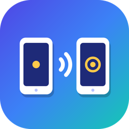
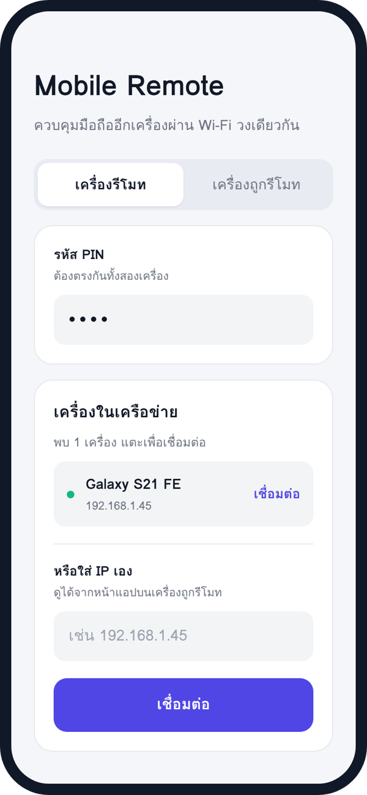
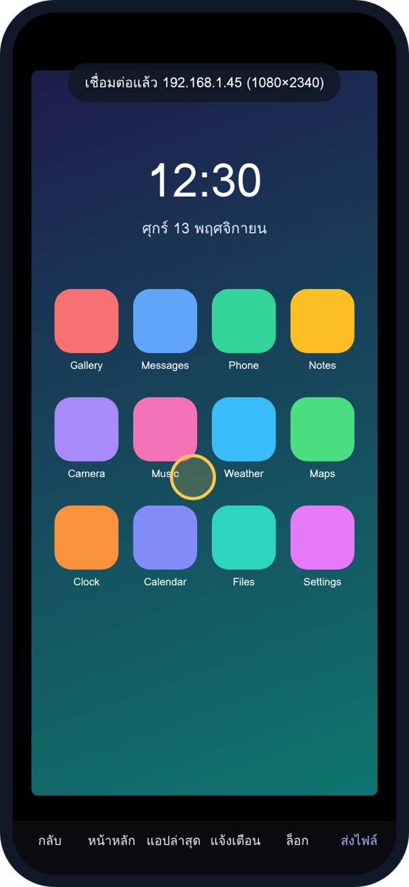
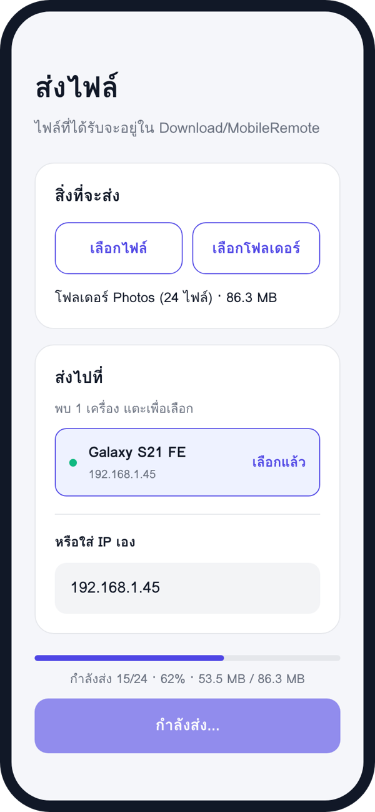
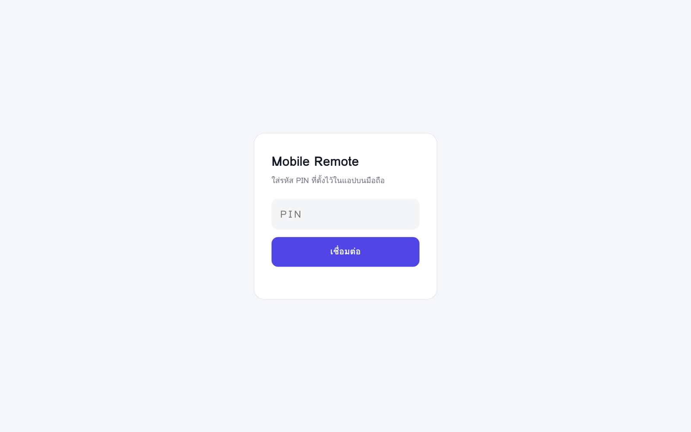
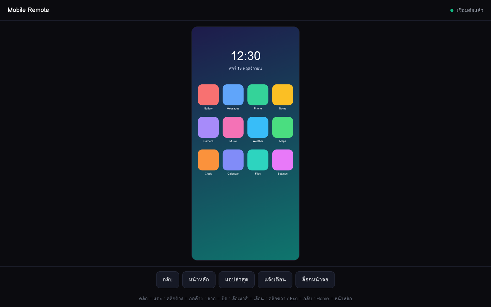

<p align="center">
  
</p>

<h1 align="center">Mobile Remote</h1>

Control one Android phone from another Android phone or from a web browser over the local network. Includes two-way file and folder transfer.

One APK covers both roles:

- **Controller**: shows the other phone's screen and sends taps, swipes, and system keys
- **Host**: shares its screen and carries out the commands it receives

No third-party libraries. The app uses only the Android SDK and the Kotlin standard library.

> Tested on Samsung Galaxy S25+ (controller) and Samsung Galaxy S21 FE (host).

<p align="center">
  
  &nbsp;
  
  &nbsp;
  
  &nbsp;
  
</p>
<p align="center"><sub>Controller home · Host home · Remote control · File transfer</sub></p>

---

## Features

- **Phone-to-phone remote control**: tap, long-press, swipe, Back, Home, Recents, notifications, and lock screen
- **Browser control**: open `http://<host-ip>:8080` on any computer on the same network to view and control the host with mouse and keyboard. Nothing to install on the computer.
- **Device discovery**: hosts announce themselves over mDNS, so controllers list them automatically. No need to type IP addresses.
- **File and folder transfer**: send multiple files or whole folders (subfolders included) in either direction. Received files are saved to `Download/MobileRemote/`.
- **PIN protection**: every connection (remote, browser, file transfer) needs the same PIN
- **Low-latency streaming**: small socket buffers, newest-frame-only rendering, and Wi-Fi low-latency mode

## Requirements

- Two Android devices running Android 11 (API 30) or later
- Both devices (and the computer, for browser control) on the same Wi-Fi network. Alternatively, connect the host to the controller's hotspot.
- A Mac or Linux computer to build the APK (`setup-dev.sh` installs everything else)

---

## Get the source

```bash
git clone https://github.com/nasongwut/Remote-Mobile-over-wifi.git
cd Remote-Mobile-over-wifi
```

## Build

### 1. Set up the development environment (once)

`setup-dev.sh` installs every tool and library needed to build, then runs a test build:

| Component | Version |
|---|---|
| JDK | 17 |
| Android command-line tools | latest (`sdkmanager`) |
| Android SDK Platform | 35 |
| Android SDK Build-Tools | 35.0.0 |
| Android SDK Platform-Tools | latest (`adb`) |
| Gradle (wrapper) | 8.9 |
| Android Gradle Plugin / Kotlin | 8.7.3 / 2.0.21 (downloaded by Gradle) |

```bash
./setup-dev.sh
```

Supported hosts: macOS (Apple Silicon or Intel, using Homebrew) and Linux (Debian/Ubuntu using apt, Fedora using dnf). On Windows, use WSL2.

The script also writes `~/.mobileremote-env` (`JAVA_HOME`, `ANDROID_HOME`, `PATH`) and sources it from `~/.zshrc` / `~/.bashrc`, so `adb` works from any new terminal.

| Option | Description |
|---|---|
| `./setup-dev.sh` | Full setup plus a verification build |
| `./setup-dev.sh --no-build` | Setup only |
| `./setup-dev.sh --doctor` | Check what is installed without changing anything |

### 2. Build

```bash
./build.sh            # build MobileRemote.apk
./build.sh install    # build and install on every phone connected over adb
./build.sh clean      # clean build
```

The output is `MobileRemote.apk` in the project root. If the environment isn't set up yet, `build.sh` runs `setup-dev.sh` first.

## Install

Install the same APK on both devices.

### Recommended: adb

Some regions require apps to come from a verified developer, and some devices block sideloaded apps. Installing through adb is exempt from developer verification.

1. On the phone, open **Settings → About phone → Software information** and tap **Build number** seven times
2. Open **Settings → Developer options** and turn on **USB debugging**
3. Connect the phone over USB and accept the authorization prompt
4. Install for the main user only. This keeps copies out of Secure Folder and Dual Messenger profiles:

```bash
adb devices
adb install --user 0 -r MobileRemote.apk
```

To connect without a cable, use wireless debugging: run `adb pair <ip>:<port>`, then `adb connect <ip>:<port>`.

### Troubleshooting

| Error | Fix |
|---|---|
| `INSTALL_FAILED_VERIFICATION_FAILURE` | Turn off **Auto Blocker** (Samsung: Settings → Security and privacy) and **Verify apps over USB**: `adb shell settings put global verifier_verify_adb_installs 0` |
| "Couldn't verify developer" when opening the APK on the phone | Install through adb instead |
| App shows up twice | It was installed into another profile. Remove it with `adb shell pm uninstall --user <id> com.mobileremote.app`. Run `adb shell pm list users` to see the profile IDs. |
| Accessibility toggle is greyed out | Settings → Apps → Mobile Remote → ⋮ → **Allow restricted settings** |

---

## Usage

Set the same **PIN** on both devices.

### Host (the phone being controlled)


1. Open the app and select **Host** (เครื่องถูกรีโมท)
2. Tap **Enable Accessibility** and turn on Mobile Remote. This lets the app perform taps and swipes.
3. Tap **Start screen sharing** and choose **Entire screen**
4. The app shows the device's IP address and its browser URL

<br clear="right">

### Controller (phone)


1. Open the app and select **Controller** (เครื่องรีโมท)
2. Tap a device in **Devices on network**, or enter the host IP manually and tap **Connect**

| Gesture on controller | Action on host |
|---|---|
| Tap | Tap |
| Hold for 0.5 s or longer | Long-press |
| Drag | Swipe or scroll |
| Bottom bar | Back · Home · Recents · Notifications · Lock · Send file |

### Controller (web browser)

Open `http://<host-ip>:8080` in Chrome, Edge, Safari, or Firefox, then enter the PIN.

<p align="center">
  
  &nbsp;
  
</p>

| Input | Action |
|---|---|
| Click | Tap |
| Click and hold | Long-press |
| Click and drag | Swipe |
| Mouse wheel | Scroll |
| Right-click or `Esc` | Back |
| `Home` | Home |

<br clear="right">

### File transfer


1. Tap **Send file** on the home screen, or in the controller's bottom bar
2. Choose **Select files** or **Select folder**
3. Pick a destination device from the list, or enter its IP, then tap **Send**

The receiving device must have the app open or be sharing its screen. Files are saved to `Download/MobileRemote/`, and a notification appears when the transfer finishes.

<br clear="right">

---

## Network ports

| Port | Protocol | Purpose |
|---|---|---|
| 8888 | TCP | Phone-to-phone screen stream and control |
| 8889 | TCP | File transfer |
| 8080 | HTTP | Browser control (MJPEG stream and commands) |

mDNS service types: `_mobileremote._tcp` (hosts sharing their screen) and `_mrfiles._tcp` (file receivers).

## Limitations

- Typing from the controller's keyboard isn't supported. Tap the host's on-screen keyboard instead.
- A locked host can't be unlocked remotely
- Apps that block screen capture (banking apps, DRM video) show a black screen
- Traffic is not encrypted, so use the app only on trusted networks
- Works on the local network only, not over the internet
- On Android 14 and later, you have to grant screen-capture permission again each time sharing starts. This is a system requirement.

---

## Development workflow

### Quick start

```bash
git clone https://github.com/nasongwut/Remote-Mobile-over-wifi.git
cd Remote-Mobile-over-wifi
./setup-dev.sh          # install JDK, Android SDK, and Gradle (once)
./build.sh install      # build and install on connected phones
```

### Commit and push

`push.sh` stages every change, commits it, and pushes the current branch to `origin`:

```bash
./push.sh "Describe your change"
```

Or with plain git:

```bash
git add -A
git commit -m "Describe your change"
git push
```

### Contributing

1. Fork the repository and create a branch: `git checkout -b feature/my-change`
2. Make your changes, then run `./build.sh` to confirm the project still builds
3. Commit and push the branch: `./push.sh "Add my change"`
4. Open a pull request on GitHub

### What is not committed

`.gitignore` excludes generated and machine-specific files:

| Ignored | Why |
|---|---|
| `.gradle/`, `.kotlin/`, `build/`, `app/build/` | Build caches and outputs |
| `local.properties` | Contains the local Android SDK path |
| `*.apk`, `*.aab`, `*.zip` | Build artifacts. Attach APKs to a GitHub Release instead. |
| `.idea/`, `*.iml` | IDE settings |
| `crash.txt`, `users.txt`, `*.log` | Debug output |

`gradle/wrapper/gradle-wrapper.jar` **is** committed, so `./gradlew` works right after cloning.

## Project structure

```
app/src/main/java/com/mobileremote/app/
├── MainActivity.kt                Home screen: role selection, PIN, device discovery
├── ControllerActivity.kt          Controller: renders the stream, converts touches to commands
├── HostService.kt                 Host: screen capture, stream server, mDNS announcement
├── RemoteAccessibilityService.kt  Host: performs gestures and global actions
├── WebServer.kt                   Host: browser control page and MJPEG stream
├── FileServer.kt                  File receiver (both roles)
├── FileTransferActivity.kt        File and folder sender, mDNS browser
└── Protocol.kt                    Ports, service types, wire protocol

docs/                              Images used in this README
setup-dev.sh                       Development environment setup
build.sh                           Build / install script
push.sh                            Commit and push helper
.gitignore                         Files excluded from git
```

### Control protocol (port 8888)

Controller to host: one text command per line. Coordinates are normalized to the range 0.0–1.0.

```
AUTH <pin>
TAP x y
LONG x y
SWIPE x1 y1 x2 y2 durationMs
KEY BACK | HOME | RECENTS | NOTIFICATIONS | LOCK
```

Host to controller: `int width, int height`, followed by repeated `int length, byte[length]` JPEG frames. A first value of `-1` means the PIN was rejected.

## License

Add your license of choice here.
